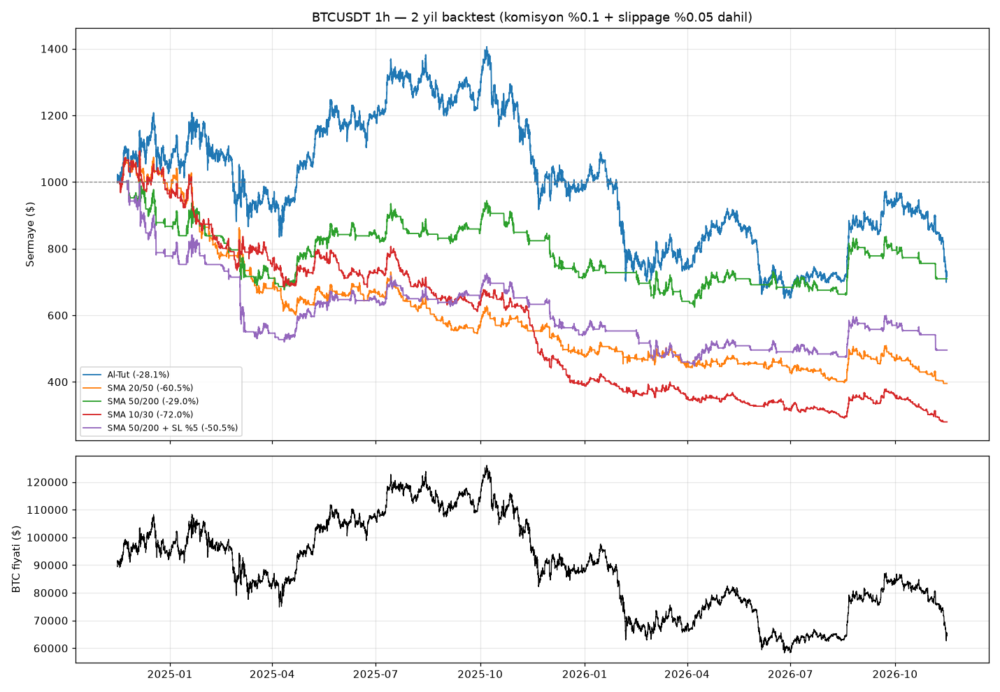

# Backtest Raporu — BTCUSDT 1h

- Veri: 17,520 mum | 2024-11-15 17:00:00+00:00 -> 2026-11-15 16:00:00+00:00
- BTC fiyat: 89,484.85 -> 64,558.65 (-27.86%)
- Maliyet: komisyon %0.10 + slippage %0.05 (her yonde)
- Sermaye: $1,000

## Motor dogrulama
- Ham fiyat degisimi: -27.8552%
- Motor (komisyonlu): -28.0714%
- Beklenen maliyet: 0.3000% | Olculen: 0.2162%
- Sonuc: **GECTI**

## Sonuclar

| Strateji | Getiri | Al-Tut | Fark | Islem | Kazanma | MaxDD | PF |
|---|---|---|---|---|---|---|---|
| Al-Tut | -28.07% | -27.86% | -0.22% | 1 | 0.0% | -53.7% | 0.00 |
| SMA 20/50 | -60.47% | -27.86% | -32.61% | 198 | 30.3% | -63.8% | 0.65 |
| SMA 50/200 | -29.05% | -27.86% | -1.19% | 63 | 27.0% | -38.1% | 0.72 |
| SMA 10/30 | -72.02% | -27.86% | -44.16% | 341 | 28.2% | -74.4% | 0.70 |
| SMA 50/200 + SL %5 | -50.46% | -27.86% | -22.60% | 76 | 25.0% | -55.5% | 0.52 |

## Ders

Fiyat %27.9 dusen bir donemde hicbir trend-takip stratejisi al-tut'u yenemedi.
Islem sayisi arttikca kayip buyudu: 341 islem = -%72, 198 islem = -%60, 63 islem = -%29.
Komisyon maliyeti islem sayisiyla dogrusal buyuyor. Formasyon stratejisi yazarken
**islem sayisini kisitlamak**, getiriden once gelen kural olmali.

